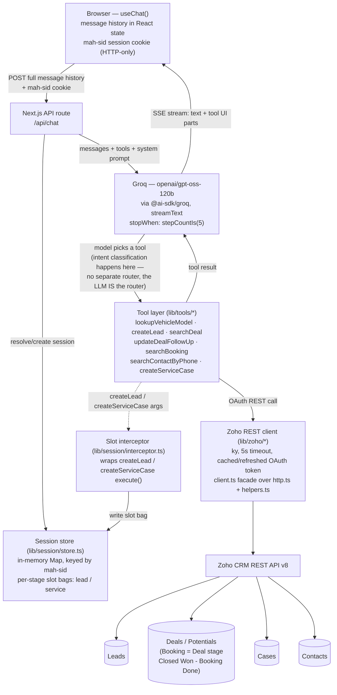

# Multistage AI Chat Agent

Automotive OEM conversational agent — recognizes which of four customer-lifecycle stages a user is in and reads/writes the matching Zoho CRM records live. Built for the AI Solutions Engineer take-home assessment; see [`docs/resources/FDE Candidate Assessment BRD.md`](./docs/resources/FDE%20Candidate%20Assessment%20BRD%20.md) for the source requirements.

Full design reasoning lives in [`docs/PRD.md`](./docs/PRD.md), decisions in [`docs/adr/`](./docs/adr/), domain vocabulary in [`CONTEXT.md`](./CONTEXT.md). This README covers only how to run the project.

## Status

App is scaffolded, architected, and functionally complete: Next.js (App Router, TypeScript, Tailwind, shadcn/ui + [AI Elements](https://ai-sdk.dev/elements)), Vercel AI SDK + Groq wired up, all 7 tools implemented against the live Zoho schema with server-side session slot tracking and `ky` HTTP client timeouts, `pnpm build`/`pnpm lint`/`pnpm test` all clean. **Provider note**: originally built against Gemini's free tier, switched to Groq after confirming live that Gemini couldn't reliably produce a first token within 20 seconds — see [`docs/adr/0004-gemini-pro-as-llm-provider.md`](./docs/adr/0004-gemini-pro-as-llm-provider.md)'s final update and [`docs/adr/0009-groq-as-llm-provider.md`](./docs/adr/0009-groq-as-llm-provider.md). Architectural decisions are documented in [`docs/adr/`](./docs/adr/) (ADR 0001 through 0012).

## Architecture



**Request lifecycle, one message at a time:**

1. Browser sends the *entire* conversation history (held client-side by `useChat`) plus the `mah-sid` session cookie to `POST /api/chat`.
2. The route resolves the session — creates one and sets the cookie on the first message, looks it up on every message after.
3. `streamText` (Vercel AI SDK) sends the history, the 7-tool schema, and the OEM system prompt to Groq. **There is no separate intent-classification step** — the LLM itself decides which of the 7 tools (if any) the message needs, which *is* the routing layer the BRD's lifecycle matrix (§2) describes.
4. If the model calls `createLead` or `createServiceCase`, the slot interceptor writes the validated arguments into that session's stage-scoped slot bag *before* the CRM call — so partial progress (e.g. name + phone collected, email still missing) is recoverable server-side, not just implied by scrollback.
5. Tools that touch Zoho go through the shared `ky` client: cached OAuth access token (proactively refreshed), 5-second hard timeout per call so a hung Zoho request can't eat the whole streaming budget.
6. On a confirmed write (`{ success: true }`), the interceptor clears that stage's slot bag — the next collection starts clean.
7. Tool results flow back into the same streamed turn (`stopWhen: stepCountIs(5)` lets the model continue past a tool call to actually phrase a reply), and the UI renders text + tool-call cards incrementally as they arrive.

**Stage → tool → Zoho module routing** (BRD §2):

| Stage | Trigger | Tool(s) | Zoho module |
| :---- | :---- | :---- | :---- |
| 1. New Lead | Spec/pricing question from an unidentified visitor | `lookupVehicleModel` → `createLead` | Leads |
| 2. Ongoing Pipeline | Phone/Deal ID to check status or update follow-up | `searchDeal`, `updateDealFollowUp` | Deals |
| 3. Booked Vehicle | Booking ID/phone to check delivery/allocation | `searchBooking` | Deals (stage = `Closed Won - Booking Done`) |
| 4. Post-Purchase/Service | Complaint or service booking from an owner | `searchContactByPhone`, `createServiceCase` | Cases, linked to Contacts |

Full architectural reasoning and trade-offs for every decision above live in [`docs/adr/`](./docs/adr/) — particularly [ADR-0002](./docs/adr/0002-groq-vercel-ai-sdk-orchestration.md) (orchestration choice), [ADR-0006](./docs/adr/0006-llm-native-intent-routing.md) (why routing is LLM-native, not a separate classifier), [ADR-0009](./docs/adr/0009-groq-as-llm-provider.md) (LLM provider), [ADR-0010](./docs/adr/0010-session-store-slot-state-ky-http-client.md) (session store, slot state, `ky`), and [ADR-0012](./docs/adr/0012-zoho-client-split-and-tool-dedup.md) (`lib/zoho/` file layout, tool boilerplate dedup).

## Environment setup

Copy `.env.example` to `.env.local` and fill in:

| Variable | Where to get it |
| :---- | :---- |
| `GROQ_API_KEY` | Free API key from [console.groq.com/keys](https://console.groq.com/keys) — no card required. (Originally Gemini; switched — see [ADR-0004](./docs/adr/0004-gemini-pro-as-llm-provider.md)'s final update for why.) |
| `ZOHO_CLIENT_ID`, `ZOHO_CLIENT_SECRET` | Create a **Self Client** at `api-console.zoho.<your-dc>` → Client Secret tab. |
| `ZOHO_REFRESH_TOKEN` | From the same Self Client's **Generate Code** tab (scope `ZohoCRM.modules.ALL,ZohoCRM.settings.ALL`), exchanged for a refresh token via a one-time POST to `https://accounts.zoho.<dc>/oauth/v2/token`. Full walkthrough: [`docs/PRD.md` §13](./docs/PRD.md#13-credentials--environment-reference). |
| `ZOHO_DC` | Your Zoho data center suffix (`com`, `in`, `eu`, ...) — visible in the API console's URL. |

**Never commit `.env.local` or paste secret values anywhere outside it** — it's gitignored by default.

## Zoho CRM: custom fields & mock data

The app depends on a few fields beyond Zoho's stock Leads/Deals schema. **Before running the seed script**, add these manually in Zoho (Setup → Customization → Modules and Fields — full rationale in [`docs/adr/0005-booking-as-deal-stage.md`](./docs/adr/0005-booking-as-deal-stage.md)):

- **Leads**: `Vehicle Model` (single line)
- **Deals**: `Booking ID` (single line), `VIN` (single line), `Allocation Status` (picklist: `In Transit` / `Dispatch Pending` / `Delivered`), `Customer Phone` (single line), `Follow Up Preference` (single line)
- **Deals → Stage picklist**: add a new value `Closed Won - Booking Done` (same probability as `Closed Won`)
- **Cases**: `Registration Number` (single line), `Odometer Reading` (number), `Preferred Service Center` (single line)

All of the above were created via the Zoho Settings API rather than the UI in this project's own setup — see [`docs/PRD.md` §14](./docs/PRD.md#14-live-zoho-schema--mock-data-as-seeded) — but adding them by hand in the UI works identically.

Then seed the three BRD-required mock records (Lead, active Deal, Booking Deal) via:

```sh
./scripts/seed-zoho-mock-data.sh
```

It reads Zoho credentials from `.env.local`, mints an access token, and creates the records through the same REST API the application itself will use. Full field-by-field reference of what gets created: [`docs/PRD.md` §14](./docs/PRD.md#14-live-zoho-schema--mock-data-as-seeded).

## Running locally

```sh
pnpm install
cp .env.example .env.local   # fill in real values — see Environment setup above
pnpm dev                     # http://localhost:3000
```

Other useful commands:

```sh
pnpm build      # production build + typecheck
pnpm lint       # Biome, via the Ultracite preset (ultracite check)
pnpm lint:fix   # auto-fix what Biome can (ultracite fix)
pnpm test       # Vitest
```

## Project structure

```
app/
  page.tsx            Thin entry point binding useChat state to ChatContainer
  api/chat/route.ts   Backend route: streamText, session resolution, tool slot interceptor
components/
  chat/               SOLID chat UI components, each single-responsibility:
                       chat-container.tsx    layout shell + prompt input wiring
                       chat-header.tsx       branding header (presentational)
                       chat-empty-state.tsx  empty hero + starter suggestion chips
                       chat-message-list.tsx scrollable message list
                       message-part.tsx      per-part (text vs. tool-call) dispatch
                       tool-card.tsx         tool-call status/args/result display
  ai-elements/        Conversation, Message, PromptInput, Tool, Suggestion, code-block
  ui/                 shadcn/ui primitives
lib/
  session/            Server-side session store (`store.ts`) & tool slot interceptor (`interceptor.ts`)
  system-prompt.ts    OEM domain system prompt (4-stage instructions)
  vehicle-catalog.ts  Local reference data backing lookupVehicleModel
  zoho/               Zoho REST client, split by responsibility (ADR-0012):
                       client.ts   public facade — `zoho` object, `criteria`
                       http.ts     ky instance + request/error-envelope wrapper
                       helpers.ts  requiredEnv() + OAuth token cache/refresh
                       errors.ts   ZohoApiError, ZohoAuthError
                       types.ts    ZohoRecord, ZohoErrorEnvelope, TokenCache
                       constants.ts  ZOHO_MODULES, DEAL_STAGES, refresh margin
  tools/              The 7 stage tools from docs/PRD.md §5
                       shared/     cross-tool helpers (ADR-0012):
                                   handle-zoho-error.ts  withZohoErrorHandling()
                                   split-full-name.ts    splitFullName()
scripts/
  seed-zoho-mock-data.sh  Seeds the BRD-required mock CRM records
docs/
  PRD.md              Full design reasoning & technical specifications
  adr/                Architectural Decision Records (0001 - 0012)
  journals/           Test scenarios & code-level user journeys
```
