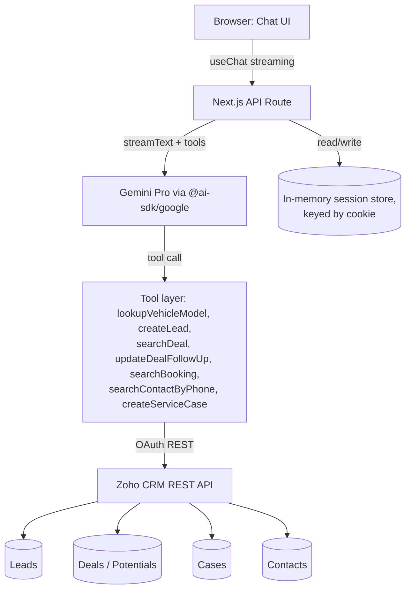

# PRD — Multistage AI Chat Agent (Automotive OEM Assessment)

Source requirements: [`docs/resources/FDE Candidate Assessment BRD.md`](./resources/FDE%20Candidate%20Assessment%20BRD%20.md). Domain vocabulary: [`CONTEXT.md`](../CONTEXT.md). Decision log: [`docs/adr/`](./adr/).

**Contents**: [0. Summary](#0-executive-summary) · [1. Objective](#1-objective) · [2. Scope](#2-scope) · [3. Tech stack](#3-tech-stack) · [4. Stage → CRM mapping](#4-lifecycle-stage--crm-mapping) · [5. Tool inventory](#5-tool-inventory-proposed) · [6. Non-functional requirements](#6-non-functional-requirements) · [7. Deployment](#7-deployment--demo) · [8. Deliverables checklist](#8-deliverables-checklist-brd-5) · [9. Architecture](#9-architecture) · [10. Rubric alignment](#10-rubric-alignment-map) · [11. Assumptions & risks](#11-assumptions--risks) · [12. Open items](#12-open-items--next-steps) · [13. Credentials reference](#13-credentials--environment-reference) · [14. Live Zoho schema](#14-live-zoho-schema--mock-data-as-seeded)

## 0. Executive summary

A take-home assessment for an AI Solutions Engineer role: build a conversational agent for an automotive OEM that recognizes which of four customer-lifecycle stages a user is in — New Lead, Ongoing Pipeline, Booked Vehicle, Post-Purchase/Service — and reads/writes the matching Zoho CRM records live, through natural conversation, with visible streaming output and graceful recovery from bad or missing input. The submission is graded on tool-routing accuracy (30%), CRM integration robustness (25%), automotive domain prompting (20%), latency/UX (15%), and code quality (10%). Every foundational decision in this document was made by optimizing directly against those five weights, not against abstract "best practice" — where the two conflicted, the rubric won.

## 1. Objective

Build a conversational AI agent for an automotive OEM (Mahindra-style) that recognizes which of four customer-lifecycle stages a user is in and reads/writes the matching Zoho CRM records in real time, entirely through natural conversation, without the user ever having to name which "mode" or "menu" they're in.

## 2. Scope

**In scope** (BRD §3, "Multistage AI Chat Agent" track):
- Responsive chat UI (not voice — the BRD offers voice as an alternative track under the same section; we are not building it).
- LLM tool-calling that routes across all 4 lifecycle stages within one session, switching context mid-conversation without the user restarting.
- Zoho CRM read/write via REST API (OAuth 2.0) across Leads, Deals, and Cases.
- Streaming responses, session-scoped conversation state, and visible recovery when the agent is missing information it needs (e.g. asking again for a Booking ID it couldn't validate).

**Out of scope, with reasoning**:
- **Voice interface.** A second, largely independent UI/latency surface (barge-in handling, speech-to-text) that the BRD does not require alongside the chat track — building both would dilute effort against a rubric that doesn't reward doing extra tracks.
- **Zoho webhooks / inbound push sync.** See [ADR-0003](./adr/0003-zoho-rest-sync-in-memory-session.md) — nothing in the rubric asks the agent to react to CRM changes made outside the conversation.
- **Durable/cross-session chat history.** See [ADR-0003](./adr/0003-zoho-rest-sync-in-memory-session.md) — Zoho is the durable system of record; conversation history is disposable working memory.
- **Production deployment, multi-tenant auth, horizontal scaling.** This is a single-evaluator, single-sitting demo (§7); building for scale would spend the 6-hour budget on infrastructure the rubric never checks.
- **Automated end-to-end test suites for the 4 flows.** Vitest is scaffolded (§3) but writing exhaustive test coverage competes directly with implementation time in a 6-hour budget; we prioritize a working, demoable agent.

## 3. Tech stack

| Layer | Choice | Why | Decision record |
| :---- | :---- | :---- | :---- |
| Framework | Next.js (App Router), TypeScript | One deployable app — frontend + API routes — instead of two repos/services to run, configure, and keep in sync | [ADR-0001](./adr/0001-nextjs-fullstack-single-app.md) |
| LLM provider | Gemini Pro (Google AI Studio, free tier) | User already holds a free-tier AI Studio key; no new signup, no cost, strong tool-calling | [ADR-0004](./adr/0004-gemini-pro-as-llm-provider.md) (supersedes [ADR-0002](./adr/0002-groq-vercel-ai-sdk-orchestration.md)) |
| Orchestration | Vercel AI SDK (`ai`, `@ai-sdk/google`) | Native streaming + tool calling, a `useChat` hook, and — as proven mid-project — a provider can be swapped without touching this layer | [ADR-0002](./adr/0002-groq-vercel-ai-sdk-orchestration.md) |
| Intent routing | LLM-native tool selection, no separate classifier | The rubric's 30%-weighted criterion *is* tool-routing accuracy; a hand-rolled router in front of it would be graded instead of the thing being graded | [ADR-0006](./adr/0006-llm-native-intent-routing.md) |
| CRM integration | Zoho CRM REST API v2/v8, OAuth 2.0 Self Client, REST-only sync | "Real-time" only needs to mean "live when asked," which a synchronous outbound call satisfies without inbound infrastructure | [ADR-0003](./adr/0003-zoho-rest-sync-in-memory-session.md) |
| Session state | In-memory, per-process, keyed by a session cookie | Zoho is already the durable system of record; conversation history doesn't need its own database | [ADR-0003](./adr/0003-zoho-rest-sync-in-memory-session.md) |
| Booking data model | A Deal at `Stage = "Closed Won – Booking Done"`, not a separate module | Reuses the Deals integration already required for Stage 2; avoids hand-provisioning a custom module schema | [ADR-0005](./adr/0005-booking-as-deal-stage.md) |
| UI | Tailwind CSS + shadcn/ui | Pairs directly with `useChat`'s message stream; fastest path to a professional OEM-branded look | — (low-stakes styling choice, not ADR-worthy) |
| Package manager | pnpm | Faster installs; user preference | — |
| Testing | Vitest, scaffolded now, real suites added alongside logic | Configuring the runner once, early, is nearly free; writing suites competes with implementation time (§2) | — |
| Diagramming | Mermaid, embedded in README and this PRD | Diffable as text, renders natively on GitHub, stays in sync as the design evolves | — |

## 4. Lifecycle stage → CRM mapping

| Stage | Trigger | Agent behavior | Zoho module / operation |
| :---- | :---- | :---- | :---- |
| 1. New Lead | Unidentified visitor asks about models/pricing/features | Answer spec/pricing query, pitch test drive, collect Name/Phone/Email/City | **Create** in `Leads`, vehicle model in a custom field |
| 2. Ongoing Pipeline | Existing prospect gives phone/deal ID | Fetch deal status, report scheduled time/quote, update follow-up prefs | **Search + update** in `Deals` |
| 3. Booked Vehicle | Customer with a paid booking asks delivery/VIN/payment link | Validate Booking ID or phone, report allocation stage | **Search** `Deals` where `Stage = "Closed Won – Booking Done"` ([ADR-0005](./adr/0005-booking-as-deal-stage.md)); custom fields for Booking ID / VIN / allocation status |
| 4. Post-Purchase/Service | Existing owner logs complaint or books service | Gather registration number, odometer, issue/service type, preferred center | **Create** in `Cases`, linked to existing `Contact` |

## 5. Tool inventory (proposed)

This is the concrete tool set [ADR-0006](./adr/0006-llm-native-intent-routing.md) refers to — a flat list exposed to the model every turn, no gating. Finalized during scaffolding, but shaped now so implementation has a clear starting contract.

| Tool | Backing | Stage(s) | Purpose | Key parameters |
| :---- | :---- | :---- | :---- | :---- |
| `lookupVehicleModel` | Local reference dataset (JSON), **not** Zoho | 1 | Authoritative specs/pricing for XUV700, Thar, Scorpio-N variants, so the agent never hallucinates a price or spec (rubric: "accurate vehicle jargon") | `model`, `variant?` |
| `createLead` | Zoho `Leads` | 1 | Register a new prospect after a vehicle-interest conversation | `fullName`, `phone`, `email`, `preferredCity`, `vehicleModel` |
| `searchDeal` | Zoho `Deals`, filters on custom `Customer_Phone` or record ID | 2 | Find an in-pipeline deal by phone or Deal ID | `phone?`, `dealId?` |
| `updateDealFollowUp` | Zoho `Deals` | 2 | Persist an updated follow-up preference on a matched deal | `dealId`, `followUpPreference` |
| `searchBooking` | Zoho `Deals`, filtered to `Stage = "Closed Won – Booking Done"` and custom `Booking_ID`/`Customer_Phone` | 3 | Find a booking by Booking ID or phone; report allocation stage / VIN / payment status | `bookingId?`, `phone?` |
| `searchContactByPhone` | Zoho `Contacts` | 3, 4 | Resolve an existing customer's Contact record before linking a Case or confirming identity | `phone` |
| `createServiceCase` | Zoho `Cases` | 4 | File a service/complaint ticket linked to an existing Contact | `contactId`, `registrationNumber`, `odometerReading`, `issueDescription`, `serviceType`, `preferredCenter` |

⚠️ No mock Contact record exists yet, so these two tools can't be exercised end-to-end today — see the open gap in [§11](#11-assumptions--risks).

Every Zoho-backed tool shares one authenticated client (§13) that handles access-token refresh transparently — tools themselves never see raw OAuth mechanics.

## 6. Non-functional requirements

- **Latency**: prioritize time-to-first-token over total completion time — the Vercel AI SDK streams both the model's own tokens and, where practical, intermediate "working on it" state while a tool call is in flight, so the UI never sits silently during a Zoho round-trip. No hard SLA is graded, but the rubric explicitly rewards low *perceived* latency (15% weight).
- **Error handling / edge-case recovery** (rubric: 30%-weighted, explicitly named): every Zoho tool call that fails (record not found, ambiguous match, expired token, rate limit) returns a structured, LLM-legible error rather than throwing — the model is expected to relay this conversationally (e.g. "I couldn't find a booking under that ID — could you double-check it?") rather than the UI showing a raw stack trace or generic error banner.
- **OAuth token management** (rubric: 25%-weighted, explicitly named "Robust OAuth 2.0 token management"): access tokens are cached in-memory with their expiry, refreshed proactively (not reactively on a 401) using the stored `refresh_token`, and refresh failures surface as a distinct, loggable error class from CRM-data errors so the two failure modes are never conflated during debugging.
- **Security**: all secrets (`GOOGLE_GENERATIVE_AI_API_KEY`, `ZOHO_CLIENT_ID`, `ZOHO_CLIENT_SECRET`, `ZOHO_REFRESH_TOKEN`) live only in `.env.local` (gitignored) with placeholders in `.env.example`; none are ever logged, committed, or pasted into planning conversations. This is not a hypothetical policy — during this planning session a freshly generated Gemini API key was pasted into chat and was immediately rotated as a result; that incident is the reason this line exists.
- **Observability**: for the scope of a local demo, structured `console` logging of each tool call (name, params, result/error, latency) is sufficient — no external logging service is justified for a single-sitting Loom recording.
- **Domain tone** (rubric: 20%-weighted "Automotive Domain Prompting"): the system prompt encodes an OEM brand voice (professional, concise, correct vehicle jargon) and structured slot-filling for service intake, rather than a generic customer-support persona.

## 7. Deployment & demo

Local-only (`pnpm dev`), screen-recorded for the required 5–7 minute Loom walkthrough covering all 4 stage scenarios plus the corresponding live updates in the Zoho CRM dashboard. No public URL is needed, since sync is REST-only ([ADR-0003](./adr/0003-zoho-rest-sync-in-memory-session.md)).

## 8. Deliverables checklist (BRD §5)

| Deliverable | Status | Notes |
| :---- | :---- | :---- |
| Private GitHub repo — modular code | ⬜ Not started | App not yet scaffolded (§12 item 4) |
| `README.md` with execution steps | 🟡 In progress | Env/Zoho setup documented; "Running locally" pending scaffold |
| `.env.example` | ✅ Done | Repo root |
| Setup script(s) | ✅ Done | [`scripts/seed-zoho-mock-data.sh`](../scripts/seed-zoho-mock-data.sh) |
| Architecture diagram | ✅ Done | §9 below (Mermaid); will also be embedded in the README once app code exists |
| Demo Loom (5–7 min) | ⬜ Not started | Blocked on scaffold + Contact gap (§11) for Stage 4 |
| ADRs for hard-to-reverse decisions | ✅ Done | [`docs/adr/`](./adr/) — 6 ADRs |
| Domain glossary | ✅ Done | [`CONTEXT.md`](../CONTEXT.md) |

## 9. Architecture

Single request lifecycle: browser sends a message → API route loads session history from the in-memory store → Vercel AI SDK streams a Gemini response, invoking one or more tools as the model decides they're needed → tools call Zoho's REST API using a cached/proactively-refreshed access token → tool results feed back into the same streamed turn → UI renders incrementally as tokens and tool results arrive.

## 10. Rubric alignment map

Explicit cross-reference from the grading rubric (BRD §6) to where each criterion is addressed, so nothing gets built without a clear line back to what's actually graded.

| Rubric line | Weight | Addressed in |
| :---- | :---- | :---- |
| Agent Design & Function Calling | 30% | §5 (tool inventory), [ADR-0006](./adr/0006-llm-native-intent-routing.md) |
| Zoho CRM Integration | 25% | §6 (OAuth/error handling), [ADR-0003](./adr/0003-zoho-rest-sync-in-memory-session.md), [ADR-0005](./adr/0005-booking-as-deal-stage.md) |
| Automotive Domain Prompting | 20% | §6 (domain tone), §5 (`lookupVehicleModel`) |
| Latency & UI/UX | 15% | §6 (latency), [ADR-0002](./adr/0002-groq-vercel-ai-sdk-orchestration.md)/[ADR-0004](./adr/0004-gemini-pro-as-llm-provider.md) (streaming mitigations) |
| Code Quality & Documentation | 10% | [ADR-0001](./adr/0001-nextjs-fullstack-single-app.md), this PRD, `CONTEXT.md`, `docs/adr/` |

## 11. Assumptions & risks

- **Assumption**: Gemini's free-tier rate limits are sufficient to run a full 4-stage demo conversation without hitting a 429 mid-recording. **Risk if wrong**: fall back to Groq per the alternative flagged in [ADR-0004](./adr/0004-gemini-pro-as-llm-provider.md) — the orchestration layer doesn't change, only the provider package and env var.
- **Assumption**: Zoho's free developer tier's API call quota (~1000/day) is not a constraint for a single demo session. **Risk if wrong**: low — the demo is a handful of calls, not sustained load.
- **Assumption**: The evaluator will run the app locally by following `README.md`, not expect a hosted link. **Risk if wrong**: revisit §7 (Vercel deploy was deliberately deferred, not ruled out).
- **Risk**: Modeling Booking as a Deal stage ([ADR-0005](./adr/0005-booking-as-deal-stage.md)) means Deals and Bookings share one object type distinguished only by `Stage` — if the evaluator's rubric implementation specifically expects a separate custom module, this reads as a deliberate, documented trade-off rather than an oversight, which is the best mitigation available for an ambiguity the BRD itself introduced.
- **Gap (open, needs a decision before Stage 4 can be demoed)**: §5's tool inventory defines `searchContactByPhone` and has `createServiceCase` require a `contactId`, but no mock **Contact** record has been created — the seed script (§14) only populates Leads and Deals. As it stands, Stage 4 (Post-Purchase/Service) has no existing owner to resolve during a demo. Two ways to close this, neither committed to yet:
  1. Extend the seed script to also create a Contact (e.g. for the Booking's owner, "Vikram Nair"), linking the Booking Deal to it via Zoho's standard `Contact_Name` lookup field on Deals — the more realistic model, since a real booking would already be tied to a Contact.
  2. Have `createServiceCase` create-a-Contact-if-missing at conversation time instead, matched by phone or registration number — closer to a real "new owner calls in for the first time" scenario, but adds a code path (and a rubric-relevant edge case) that needs its own error handling.
  This will be resolved during scaffolding (§12 item 4), not in this planning session.

## 12. Open items / next steps

1. ~~Zoho CRM Self Client setup~~ — done (§13).
2. ~~Populate Zoho mock data~~ — done (§14).
3. ~~Repo housekeeping~~ — `.gitignore` added, covering `.env.local` (was previously unprotected — a real risk given real credentials now exist on disk), `.agents/`, `skills-lock.json`. `AGENTS.md`/`docs/agents/*` left as-is for now, pending whether the GitHub-issue-tracker workflow they describe actually gets used for this project.
4. Scaffold the Next.js app, wire up the tool layer (§5) against the live schema in §14, implement the 4 flows.

## 13. Credentials & environment reference

All secrets live in `.env.local` (gitignored), documented with placeholders in `.env.example`. **Never pasted into chat or committed.**

| Variable | Purpose | Status |
| :---- | :---- | :---- |
| `GOOGLE_GENERATIVE_AI_API_KEY` | Gemini API access (Google AI Studio, free tier) | ✅ Obtained ([ADR-0004](./adr/0004-gemini-pro-as-llm-provider.md)); rotated once after an initial key was pasted into the planning chat and treated as compromised |
| `ZOHO_CLIENT_ID` | Self Client OAuth credential | ✅ Obtained |
| `ZOHO_CLIENT_SECRET` | Self Client OAuth credential | ✅ Obtained |
| `ZOHO_REFRESH_TOKEN` | Long-lived token to mint access tokens | ✅ Obtained via one-time grant-code exchange (below) |
| `ZOHO_DC` | Data center domain (`com`, `in`, `eu`, ...) — determines API/accounts host | ✅ `in` (confirmed from `api-console.zoho.in`) |

### How the Zoho refresh token was obtained

1. Created a **Self Client** at `api-console.zoho.in`, scope `ZohoCRM.modules.ALL,ZohoCRM.settings.ALL`.
2. Copied `client_id`/`client_secret` (Client Secret tab, non-expiring) into `.env.local`.
3. Generated a one-time grant code (Generate Code tab, 3-minute expiry), pasted it into `.env.local` as a throwaway `ZOHO_GRANT_CODE` value — never into chat.
4. Exchanged it for a `refresh_token` via a single POST to `https://accounts.zoho.in/oauth/v2/token`, run as a local shell command that sourced `.env.local` for its inputs and wrote the result straight back into `.env.local`. The spent grant code was deleted from the file immediately after.
5. `CLIENT_ID`/`CLIENT_SECRET` were then renamed to `ZOHO_CLIENT_ID`/`ZOHO_CLIENT_SECRET` to match this table.

At no point did a real secret value appear in the planning conversation — only variable *names*, status, and (once) a redacted Zoho error code. This is the pattern to reuse for any future credential work on this project.

## 14. Live Zoho schema & mock data (as seeded)

Custom fields added beyond Zoho's stock Leads/Deals schema, confirmed via a read-only Settings API call rather than assumed from labels:

| Module | Field label | API name | Type |
| :---- | :---- | :---- | :---- |
| Leads | Vehicle Model | `Vehicle_Model` | text |
| Deals | VIN | `VIN` | text |
| Deals | Booking ID | `Booking_ID` | text |
| Deals | Allocation Status | `Allocation_Status` | picklist (`In Transit`, `Dispatch Pending`, `Delivered`) |
| Deals | Customer Phone | `Customer_Phone` | text — added mid-session; standard Deals has no phone field, and both `searchDeal` and `searchBooking` (§5) need to filter by phone per the BRD's own trigger language |

Deals' `Stage` picklist also got one new value: `Closed Won - Booking Done` (§ADR-0005), same probability as the stock `Closed Won`.

Mock data seeded via [`scripts/seed-zoho-mock-data.sh`](../scripts/seed-zoho-mock-data.sh) (idempotent to re-run only if you intend duplicates):

| Record | Module | Key fields |
| :---- | :---- | :---- |
| Rajesh Sharma | Leads | `Vehicle_Model = Thar`, Pune, mock phone/email |
| Priya Patel – XUV700 | Deals | `Stage = Proposal/Price Quote`, `Customer_Phone` set, ₹19,00,000 mock quote |
| Booking #MAH-9921 – Scorpio-N Z8L (Vikram Nair) | Deals | `Stage = Closed Won - Booking Done`, `Booking_ID = MAH-9921`, `Allocation_Status = Dispatch Pending`, `VIN` deliberately unset (realistic "not yet allocated" state for the Stage-3 VIN query) |

All three were created through the live Zoho REST API using the credentials in §13 — the same code path the application's tool layer will use — rather than through the Zoho UI, which incidentally already exercises and validates the OAuth setup end-to-end.
